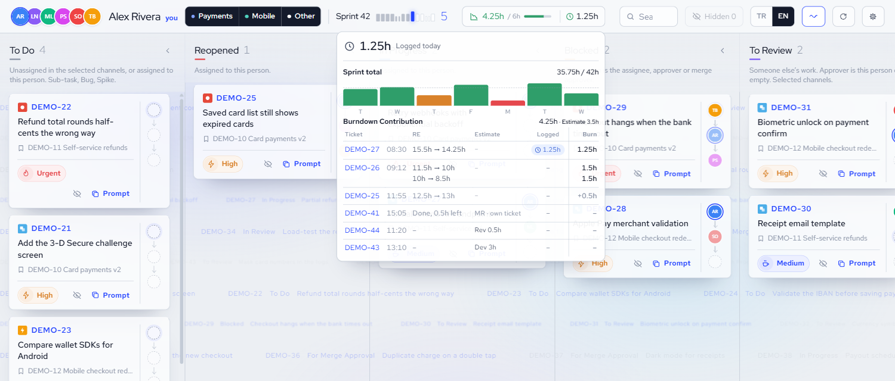

<div align="center">

# 🎯 Sprint Focus Board

### One person's slice of a Jira Cloud sprint: what to pick up, what waits for their review, and how much they burned today. Local, one Python file, no dependencies.

[](./LICENSE)
[](https://www.python.org)
[](#-quick-start)
[](#-quick-start)
[](#-security--privacy)

**🟦 Pick up** → **🟧 Work** → **🟪 Review** → **🟩 Merge**: the sprint as one person meets it, not as a wall of tickets.

**Jump to:** [Quick start](#-quick-start) · [Let an AI agent install it](#-let-an-ai-agent-install-it) · [Configuration](#-configuration) · [Burndown](#-how-the-burndown-is-calculated)

</div>

---

## 📋 Project status — read this first

> **Status: personal-first, maintenance mode.** Sprint Focus Board is built for its author's own daily
> use and open-sourced as-is under the MIT licence. Bugs that get in the author's way are fixed;
> everything else is best-effort. There is no roadmap commitment, no SLA and no support channel
> beyond GitHub issues.

### ✅ What works

- **The board** against a Jira Cloud Scrum board with an active sprint: per-person columns, the person picker, search, hide and restore, folding columns, English and Turkish.
- **Configurable workflow**: columns, their statuses, issue-type filters and rule types, with 0..n reviewer roles.
- **Burndown contribution**: daily and sprint-to-date Remaining Estimate drops per person, with worklogs booked on the day the work started.
- **Setup wizard** on the first start (and later from Settings): sprint, team, channels, column prompts and refresh rate.
- **Setup helpers**: `--check`, `--list-boards` and `--list-fields` find the values the config needs.
- **A demo** with made-up data (`python demo/demo.py`) that needs no Jira at all.

### 🚧 Experimental / incomplete

- **Estimate-comment comparison** (`burndown.estimateComment`) is lightly used and off by default.
- **Jira Server / Data Center** is untested. The site URL must be a plain `https://host`, without a context path.
- **Two UI languages** only: English and Turkish.

### ⚠️ Known risks

- **It reads Jira with your own token.** Whatever your account can see, the board can show. The token never reaches the page, but anyone who can use your computer's loopback interface can read the board while it runs.
- **The sprint burndown reads every changed ticket's changelog.** On a large sprint the first load takes a few seconds; results are cached per ticket after that.
- **No CI.** The tests run locally with `python -m unittest discover -s tests`.

---

<div align="center">

[](./docs/images/board.png)

<sub>Made-up demo data. Each card shows its priority, type, parent story and the hand-off chain (assignee, approver, merge approver). <a href="./docs/images/board.png">Click to enlarge.</a></sub>

</div>

---

## ⚡ Why Sprint Focus Board?

A team board answers "where is everything?". During the day the question is narrower:

- 🧭 **What can I pick up**, without scrolling past other people's work?
- 👀 **What is waiting for my review**, including tickets whose reviewer is still empty?
- 🔁 **What came back to me**: reopened or blocked work where I am the assignee or a reviewer.
- 📉 **Did I move the sprint today?** Remaining Estimate burned, not hours logged.

**Sprint Focus Board answers those for any person on the sprint**, one click apart, and copies a ready-made prompt for your AI coding assistant from any card.

---

## ✨ What's inside

| | |
|---|---|
| 🧱 **Columns per status** | Each column lists Jira statuses and a rule for the picked person: `unassigned`, `assignee`, `involved`, `role` or `any`. The defaults cover To Do → Reopened → In Progress → Blocked → To Review → In Review → For Merge Approval. |
| 👥 **Person picker** | Everyone who is an assignee or reviewer in the sprint. The board opens on the owner of the API token; `?u=<accountId>` links straight to someone else. |
| 🔗 **Hand-off chain** | Assignee → each configured reviewer role (any user-picker fields, 0..n). The stage the column stands for is highlighted. |
| 🏁 **Last open sub-task** | A sub-task that is the only open one left in its story gets waving finish flags and sorts between P1 and P2, whatever its own priority below P1. |
| ⊗ **Blocker** | A ticket that holds up open tickets through a Jira "Blocks" link shows a circled X with the count. Hover or click it for the waiting tickets, each one a link to Jira. Blockers sort first within their priority. |
| 🏷️ **Channel chips** | Optional team streams, defined by epics, label and component glob patterns, and a summary regex. Hidden when none are configured. |
| 📋 **Prompt per card** | Per-column templates with `{key}`, `{summary}`, `{url}`, `{status}` and more, in one language or per language. Neutral defaults; bring your own workflow. |
| 🔥 **Burndown contribution** | Today's Remaining Estimate drop against a daily target and the time logged today, a sprint-to-date chart, and one row per ticket behind both. |
| 🗂️ **Board hygiene** | Search (`/`), hide a card until its status changes, fold columns, empty columns fold themselves. Choices are remembered per browser. |
| 🎬 **Refresh show** | A worker rummages through a Jira crate while the data loads, then throws each card into its column. Follows the OS "reduce motion" setting; the Motion button overrides it. |
| 🧙 **Setup wizard** | Opens on the first start and from **Settings**: pick the board's active sprint, build the team by searching Jira, define channels from the sprint's epics, labels, components and title keywords with live match counts, rewrite the column prompts (for your own commands or skills), and set the refresh rate. Saved to `settings.json` and applied without a restart. |
| 🧰 **Setup helpers** | `--check` shows how the sprint's statuses map to columns; `--list-boards` and `--list-fields` find board ids and reviewer fields. |
| 🔒 **Local by design** | Binds `127.0.0.1`, answers only to localhost host names, keeps the token in the Python process. |

**Server:** Python ≥ 3.10 standard library only (`http.server`, `urllib`, `json`). **Page:** one HTML file, no build step.

---

## 🖼️ Product tour

<div align="center">

[](./docs/images/burndown.png)

<sub><b>Burndown contribution.</b> Time logged today at the top, the sprint-to-date chart, then one row per ticket: its Remaining Estimate change (a worklog counts at its start time), the optional estimate-comment value, the time logged today and the burn.</sub>

<br><br>

[](./docs/images/reviewer-tr.png)

<sub><b>Someone else's view.</b> The same sprint for a reviewer, in Turkish, with one channel switched off. The empty Reopened column has folded itself.</sub>

<br><br>

[](./docs/images/setup-channels.png)

<sub><b>Setup wizard: channels.</b> Click the sprint's epics, labels or components to add them to a channel, or type title keywords; each channel shows how many open tickets it gets, and what is left is "Other".</sub>

<br><br>

[](./docs/images/setup-sprint.png) [](./docs/images/setup-prompts.png)

<sub><b>Setup wizard: sprint and prompts.</b> The sprint step derives a name prefix so the board follows the next sprint by itself. The prompts step edits each column's template per language.</sub>

<br><br>

[](./docs/images/refresh-show.png)

<sub><b>Refresh show.</b> Plays on the first load and on Refresh; click or press Esc to skip it.</sub>

</div>

---

## 🚀 Quick start

**Requires:** Python ≥ 3.10 · a Jira Cloud site with a Scrum board · an Atlassian API token · Windows, macOS or Linux.

### 1. Try the demo (no Jira needed)

```bash
git clone https://github.com/edgeetech/sprint-focus-board.git
cd sprint-focus-board
python demo/demo.py --open
```

The demo runs a fake Jira inside the same process, with a made-up team and a sprint built around today's date. `--first-run` starts it without a board, so the setup wizard opens. Stop it with Ctrl+C.

### 2. Connect your Jira

1. **Create an API token** at <https://id.atlassian.com/manage-profile/security/api-tokens> (*Create API token*). The board only reads.
2. **Store the credentials.** Copy `.env.example` to `.env` (git ignores it) and fill it in:

   ```ini
   JIRA_BASE_URL=https://your-site.atlassian.net
   JIRA_EMAIL=you@your-company.com
   JIRA_API_TOKEN=your-token
   ```

   Real environment variables win over `.env`; `--env-file PATH` or `BOARD_ENV_FILE` points at another file. `JIRA_URL` and `JIRA_USERNAME` work as aliases. Already using the Atlassian MCP server? Set `jira.mcpConfig` in `config.jsonc` to your `.mcp.json` instead, and the board reads the credentials from there.
3. **Optional: reviewer roles and language.** If your tickets have user-picker fields for the people who review after the assignee, copy `config.example.jsonc` to `config.jsonc` (git ignores it) and list them under `reviewerRoles`; `python board.py --list-fields` shows their ids. Set `ui.defaultLanguage` there too.
4. **Run and finish the setup in the browser.**

   ```bash
   python board.py --open
   ```

   The board is at <http://localhost:8765>. On the first start the setup wizard asks for the sprint, the team, the channels, the column prompts and the refresh rate, and saves them to `settings.json` (git ignores it). **Settings** in the header reopens it.
5. **Check the workflow.** `python board.py --check` shows which statuses land in which column, how often each reviewer field is filled, and the channel candidates and matches. Map unshown statuses to columns in `config.jsonc` and restart.

Options: `--port`, `--config PATH` (or `BOARD_CONFIG`), `--board ID`, `--sprint-prefix TEXT`, `--open`, `--check`, `--list-boards [NAME]`, `--list-fields`. `BOARD_SETTINGS` points the wizard at another settings file.

---

## 🤖 Let an AI agent install it

Give your coding agent (Claude Code, Codex, Copilot or similar) this prompt:

```text
Install Sprint Focus Board (https://github.com/edgeetech/sprint-focus-board) on my machine.
Follow AGENTS.md in that repository: ask me for what it needs, and finish when the board runs on localhost.
```

[AGENTS.md](./AGENTS.md) is the agent's runbook. The agent checks Python, gets the code, runs the demo, connects Jira, asks about reviewer fields and language, and starts the board. You finish the setup wizard in the browser (sprint, team, channels, prompts, refresh); the agent then maps any unshown statuses with `--check` and verifies the running board. It never asks you to paste the API token into the chat; you put it in `.env` yourself.

---

## ⚙️ Configuration

Settings come from three layers, each overriding the one before: the built-in defaults, `config.jsonc` (yours, JSON with `//` and `/* */` comments), and `settings.json` (written by the setup wizard; it holds only the `board.id`, `board.sprintNamePrefix`, `team`, `channels`, `prompts` and `ui.refreshSeconds` values that differ from `config.jsonc`, so later edits of `config.jsonc` still apply, and a prompt's **Reset** goes back to the `config.jsonc` text). [`config.example.jsonc`](./config.example.jsonc) documents every option; this is the overview.

| Key | What it controls |
| --- | --- |
| `jira.baseUrl`, `jira.email` | Site and account, if you prefer them in the file. The environment wins. The token is never read from here. |
| `board.id` | The board whose active sprint is shown. Without it the board starts in the setup wizard. |
| `board.sprintNamePrefix` | Pick the active sprint whose name starts with this text, for boards that run several sprints at once. |
| `board.ignoreStatusSuffixes` | Suffixes stripped from status names, such as `(migrated)`. |
| `server.port` | Port on 127.0.0.1 (default 8765). |
| `ui.defaultLanguage`, `ui.refreshSeconds` | `en` or `tr`; how often the page reloads the board. |
| `reviewerRoles` | 0..n user-picker fields that form the hand-off chain, each with an `id`, a `field` and a `label`. |
| `team` | The people in the person picker (`id` = Jira accountId, plus `name` and `avatar`). Empty means everyone in the sprint. The wizard fills it. |
| `columns` | The columns: statuses, issue-type filters, rule, colour, description and prompt templates. |
| `channels` | Optional chips: `epics`, `labels`, `components` (glob patterns), `keywords` (whole words in titles) and a `summary` regex per channel. Tickets in no channel are "Other". Leave it empty and the chips disappear; no column filters by channel. |
| `prompts` | Per-column prompt overrides, `{ "<column id>": { "prompt": ..., "promptIfNotAssignee": ... } }`. The wizard writes them; the column's own `prompt` stays the default. |
| `promptVars` | Extra placeholders that depend on the ticket, such as `{review}` = `/review-web` for `WEB-*` keys and `/review-api` otherwise. The first matching rule (key patterns, issue types) wins. |
| `jira.mcpConfig` | Path to an MCP config (such as `.mcp.json`) whose Atlassian entry holds `JIRA_URL`, `JIRA_USERNAME` and `JIRA_API_TOKEN`; the board reads them from there so the token is not copied. `JIRA_MCP_CONFIG` does the same. |
| `priorities` | Priority name → level 1..5, for the icons and the sort order. `P1`..`P5` names are read directly. |
| `burndown` | Time zone, daily target, colour thresholds, weekend days, excluded types, done statuses and the optional estimate-comment comparison. |

### Column rules

A ticket goes to the first column whose statuses and issue types match and whose rule holds for the picked person.

| Rule | Shows a ticket when |
| --- | --- |
| `unassigned` | nobody is assigned. `orAssignee: true` (the To Do default) also shows the person's own tickets, whatever channels are selected. |
| `assignee` | the person is the assignee |
| `involved` | the person is the assignee or holds any reviewer role (or the roles listed in `roles`) |
| `role` | the person holds `role`. When the role is empty, anyone may take it (`whenEmpty: "anyone"`) except people in `emptyExcludes`, or nobody (`whenEmpty: "nobody"`). `notAssignee: true` hides the person's own tickets. |
| `any` | always |

With no reviewer roles configured, every role counts as empty: the review columns show other people's tickets in those statuses, and the hand-off chain shows the assignee only.

### Prompts

Each column has a prompt template, as one string or per language (`{ "en": "...", "tr": "..." }`). `promptIfNotAssignee` is used when the picked person is not the assignee. Placeholders: `{key}`, `{summary}`, `{url}`, `{type}`, `{status}`, `{parentKey}`, `{parentSummary}`, `{assignee}`, plus any `promptVars` you define, so one template can start with the right command for each repository (for example `{review} {key}`).

### Time zones

`burndown.timezone` takes `local` (this computer, the default), `UTC`, a fixed offset such as `+02:00`, or an IANA name such as `Europe/Berlin`. IANA names need a time zone database. Windows has none, so either run `python -m pip install tzdata` or set `burndown.timezoneFallback` to a standard offset plus the `eu` or `us` daylight-saving rule. Without either, the board stops at startup and says so.

---

## 🔥 How the burndown is calculated

The **burndown contribution** of a person on a day is the sum of the drops in **Remaining Estimate** (`timeestimate`) that this person made on that day, read from each ticket's changelog.

- **Who**: the author of the change. A drop counts in full for the person who made it, whoever the assignee is.
- **When**: the local day of the change, in the configured time zone. A drop that comes from logging work (the change carries a `WorklogId`) counts on the worklog's **started** day instead.
- **Increases** are listed as "estimate raised" and are not subtracted.
- **Scope**: tickets in the active sprint updated since the day before the range, without `burndown.excludeTypes` (Story and Epic by default; their estimates usually roll up from sub-tasks).
- **Done with time left**: a move to a done status that leaves Remaining Estimate is listed for reference and does not count.

The button shows today's total against `dailyTargetHours`: red below `thresholds.low`, amber below `thresholds.mid`, green above. The popover adds the sprint-to-date chart (working days from the sprint start to today, against target × working days) and the list of changes.

**Optional comparison.** With `burndown.estimateComment.enabled`, an estimate comment such as `Dev: 4h | Rev: 1h | MR: 30m` values each configured stage move. The first time a ticket makes a stage's move, the person who made it is credited with that stage's hours, if `by` allows it (the assignee, or anyone else). The newest full line wins; without one, the newest single `Rev: 1h`-style values are used. It is shown next to the main figure only for comparison and costs one extra Jira call per ticket.

---

## 🧠 How it works

```
   Browser  http://localhost:8765
        │   /  ·  /api/board  ·  /api/burn  ·  /icon
        ▼
  ┌──────────────────────────────────────────────────────┐
  │ board.py   Python stdlib, 127.0.0.1 only             │
  │ • config.jsonc + .env (the token stays here)         │
  │ • board + burndown worked out in the background,     │
  │   answers cached 20 s (202 while working)            │
  │ • at most 8 Jira connections · retry on timeout/5xx  │
  │ • per-ticket changelog cache, keyed on `updated`     │
  └──────────────────────┬───────────────────────────────┘
                         │ HTTPS · Basic auth (email + API token) · read-only
                         ▼
             Jira Cloud REST v3 + Agile API
```

- **Board**: `/rest/api/3/myself`, `/rest/agile/1.0/board/{id}/sprint?state=active`, `/rest/api/3/search/jql`. Parent stories are fetched only when channels are configured.
- **Burndown**: per changed ticket, the changelog, the worklogs (only when the changelog has worklog entries) and, with the comparison on, the comments. The sprint burndown is warmed up in the background at startup.
- **Rate limits**: a 429 is retried once after its `Retry-After` (up to 10 s).
- **No long-held requests**: `/api/board` and `/api/burn` never keep a connection open while Jira is read. Without a fresh answer they reply `202 {"pending": true, "stale": <last answer or null>}` at once and work it out in the background; the page shows the stale answer, if any, and asks again every one or two seconds. A page that is reloaded or closed meanwhile leaves nothing half-sent.
- **Local API**: `/api/board` and `/api/burn` (`?day=YYYY-MM-DD`, `?scope=sprint`) take `?force=1` to skip the cache. Ask again until the answer is not 202. `/icon?u=` proxies issue-type icons on your Jira site, which need authentication.

---

## 🔒 Security & privacy

- **127.0.0.1 only.** The server refuses any `Host` header other than `localhost:<port>` or `127.0.0.1:<port>` (DNS-rebinding guard).
- **The token stays in the Python process.** The page gets issue data, never credentials. The config file refuses an `apiToken` key.
- **Read-only.** The board only sends GET requests to Jira.
- **Guarded local writes.** The wizard's save and preview requests need a per-process token that only the board's own page holds, a JSON body and, when the browser sends one, a localhost `Origin`; other web pages cannot change the settings.
- **Narrow icon proxy.** `/icon` fetches URLs on your own Jira site only.
- **No telemetry.** Nothing leaves your machine except the Jira requests. Page fonts come from Google Fonts.

---

## 📂 Where data lives

| What | Where |
| --- | --- |
| Credentials | `.env` next to `board.py`, or your environment. Git ignores `.env`. |
| Settings | `config.jsonc` (or `config.json`) next to `board.py`, yours. `settings.json` next to it, the wizard's (`BOARD_SETTINGS` moves it). Git ignores all three. Delete `settings.json` to run the wizard from scratch. |
| Jira data | In memory only, while the server runs. Nothing is written to disk. |
| Page choices | The browser's `localStorage` for `localhost:<port>`: language, picked person, hidden cards, folded columns, channels, motion. |

---

## 🧪 Development

```bash
python -m unittest discover -s tests   # tests
python demo/demo.py --port 8765        # the board on made-up data
```

`board.py` rereads `board.html` on every request, so page edits show on refresh; config changes need a restart; wizard changes apply at once. The README screenshots come from the demo at 2240 × 840 (board), 1500 × 640 (burndown), 1600 × 760 (refresh show) and, with `--first-run`, 1500 × 900 (setup wizard).

---

## 🤝 Contributing

Issues and pull requests are welcome at [github.com/edgeetech/sprint-focus-board](https://github.com/edgeetech/sprint-focus-board). Keep it dependency-free, and keep team-specific behaviour in the config, not in the code.

---

## 📄 License

[MIT](./LICENSE). Jira is a trademark of Atlassian. This project is not affiliated with or endorsed by Atlassian.

---

<div align="center">

Crafted at **EdgeeTech Limited** · [github.com/edgeetech/sprint-focus-board](https://github.com/edgeetech/sprint-focus-board)

⭐ If Sprint Focus Board keeps your day in focus, drop a star — it helps others find it.

</div>
